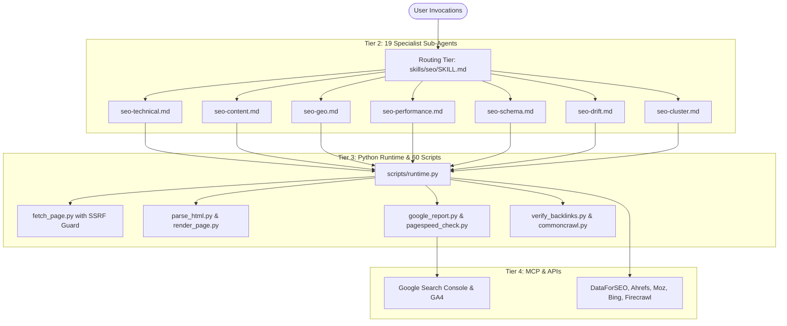

# Architecture Deep Dive: Claude SEO

## 1. System Overview

**Claude SEO** uses a decoupled, agentic architecture built on four primary layers:

---

## 2. Orchestration & Delegation Protocol

1. **Progressive Disclosure:** Instead of feeding all skills into the model context at once, the system routes requests via `skills/seo/SKILL.md`.
2. **Deterministic Outputs:** Agents do not guess; each sub-agent delegates execution to Python scripts in `scripts/`, receives JSON output, and formats it into actionable audit tables.
3. **Concurrency:** When running `/seo audit <url>`, the orchestrator initiates up to 17 parallel sub-agent tasks covering performance, technical SEO, mobile friendliness, content E-E-A-T, and structured schema.
